<!-- Please do not change this logo with link -->

<a target="_blank" href="https://www.microchip.com/" id="top-of-page">
   <picture>
      <source media="(prefers-color-scheme: light)" srcset="images/mchp_logo_light.png" width="350">
      <source media="(prefers-color-scheme: dark)" srcset="images/mchp_logo_dark.png" width="350">
      
   </picture>
</a>

# Using the RTC as a Periodic Counter for PIC32CM GC Devices

This example project uses the PIC32CM GC00 Curiosity Nano + Touch Board to demonstrate how to use the Real-Time Counter (RTC) peripheral as a periodic timer. The RTC is configured to generate an interrupt every 250 ms. A software interrupt handler is used to toggle LED0 on the board.

## Related Documentation

- [PIC32CM Product Page](https://www.microchip.com/en-us/products/microcontrollers/32-bit-mcus/pic32-sam/pic32cm-gc?utm_source=GitHub&utm_medium=TextLink&utm_campaign=MCU8_PIC32CM-GC00&utm_content=pic32cmgc-cnano-clock-config-vscode-harmony-github&utm_bu=MCU08)

## Software Used

- [Visual Studio Code® (VS Code®) v1.142](https://code.visualstudio.com/Download) or newer
- [MPLAB® Tools for VS Code® Extension Pack v1.2.8](https://www.microchip.com/en-us/tools-resources/develop/mplab-tools-vs-code?utm_source=GitHub&utm_medium=TextLink&utm_campaign=MCU8_PIC32CM-GC00&utm_content=pic32cmgc-cnano-clock-config-vscode-harmony-github&utm_bu=MCU08) or newer
   - [MPLAB® Data Visualizer](https://www.microchip.com/en-us/tools-resources/debug/mplab-data-visualizer?utm_source=GitHub&utm_medium=TextLink&utm_campaign=MCU8_PIC32CM-GC00&utm_content=pic32cmgc-cnano-clock-config-vscode-harmony-github&utm_bu=MCU08)
- [MPLAB® XC32 v6.00](https://www.microchip.com/en-us/tools-resources/develop/mplab-xc-compilers/xc32?utm_source=GitHub&utm_medium=TextLink&utm_campaign=MCU8_PIC32CM-GC00&utm_content=pic32cmgc-cnano-clock-config-vscode-harmony-github&utm_bu=MCU08) or newer
- [Microchip PIC32CM-GC00 Series Device Support v1.0.27](https://packs.download.microchip.com/#collapse-Microchip-PIC32CM-GC00-DFP-pdsc) or newer

## Hardware Used

- [PIC32CM GC00 Curiosity Nano + Touch Evaluation Kit](https://www.microchip.com/en-us/development-tool/ev23z30a?utm_source=GitHub&utm_medium=TextLink&utm_campaign=MCU8_PIC32CM-GC00&utm_content=pic32cmgc-cnano-clock-config-vscode-harmony-github&utm_bu=MCU08)

   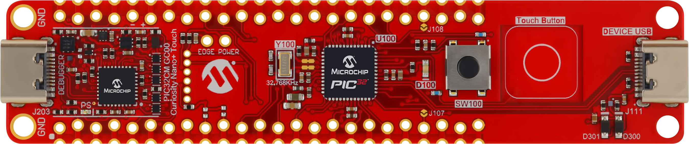

- USB Type-C® cable

## Operation

In this example, the RTC is operating as a 32-bit counter, incrementing on every 0-to-1 transition (rising edge) of the RTC source clock. To achieve the desired period time in seconds, compute the appropriate value to be loaded into the Compare (COMP_n) registers using the formula below.

`
COMP_n = ((PeriodTimeInSeconds) * (RTCSourceClockFrequencyInHertz)) - 1
`

To achieve a period of 250 ms with the RTC source clock configured to operate at 1.024 kHz, compute the value to be loaded into the Compare0 (COMP_0) register as:

`
COMP_0 = (0.25s * 1024 Hz) - 1 = 255 = 0xFF
`

The RTC continuously compares the counter value with the Compare register and when a match occurs, an interrupt flag is set on the next rising edge of the RTC clock. The application software will then handle the interrupt and toggle the LED0 and DEBUG pins. If Clear on Compare Match is enabled, the counter is cleared when a compare match occurs.

**Figure 1.** RTC Operation Flowchart

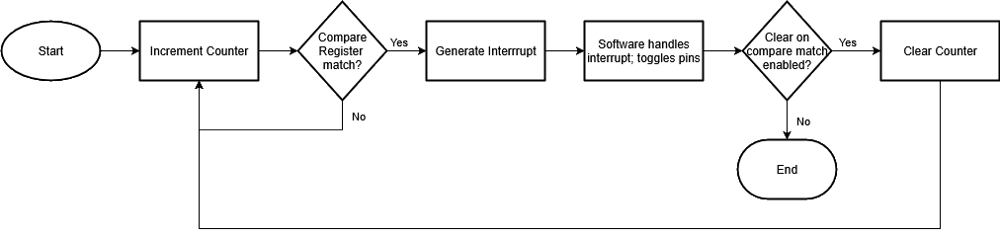

## Running the Example Project

1. Connect the USB Type-C Debugger Connector of the PIC32CM GC00 Curiosity Nano board to a PC using a USB Type-C cable.
2. If not already in your system, download and install the latest version of VS Code and the MPLAB Tools for VS Code extension.
3. If not already in your system, download and install the XC32 C-Compiler v6.00 or newer.
4. Clone or download this project from GitHub to your local machine.
5. If downloaded as a `.zip` file, extract the files to a location as close as possible to the root directory (e.g., C:/) before moving to the next step.
6. In VS Code, go to _File>Open Folder_. Navigate to the location where the project was extracted and select the `pic32cmgc-cnano-rtc-periodic-vscode-harmony` folder. Click the **Select Folder** button to open the project. The MPLAB extension will automatically detect it as an MPLAB project.

    **Figure 2.** Opening the VS Code® Project

    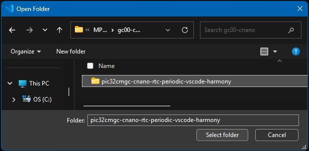

7. Press CTRL + Shift + P to open the command palette. Type "MPLAB CMake: Clean and build" and select it. Choose the default configuration for building the project.

   **Figure 3.** Clean and Build Command

   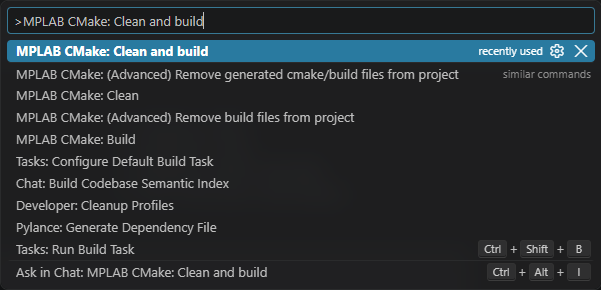

   Wait for the build to finish. Verify that the terminal displays the message "CMake Build successful. (exit code 0)".

   **Figure 4.** Build Successful

   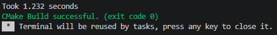

8. Press CTRL + Shift + P again. Type "MPLAB: Program device" and select it.

   **Figure 5.** Program Device Command

   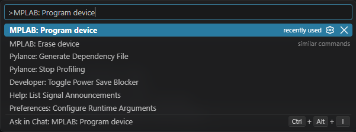

9. Verify that the program is running (see Figure 6).

    **Figure 6.** Program Complete

    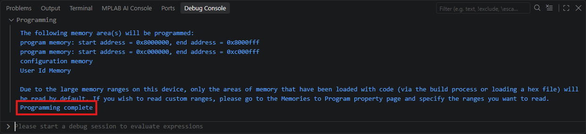

10. LED0 on the PIC32CM GC00 Curiosity Nano board is now toggling every ~250 ms. To verify the timing, the DEBUG GPIO 0 pin (PC03) is toggling simultaneously with LED0. To view the output, launch MPLAB Data Visualizer by pressing CTRL + Shift + P and typing `MPLAB: Data Visualizer` in the VS Code command palette.

    **Figure 7.** LED0 on the PIC32CM GC00 Curiosity Nano Board

    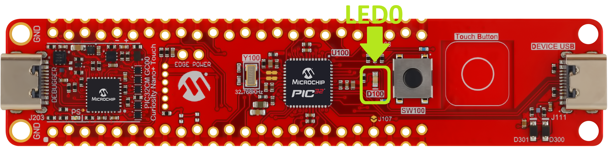

    **Figure 8.** DEBUG GPIO 0 Pin on the PIC32CM GC00 Curiosity Nano Board

    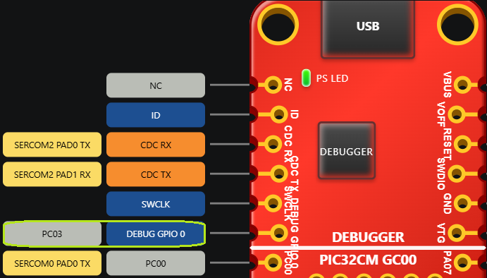

11. In MPLAB Data Visualizer, find the Debug GPIO port for the PIC32CM GC00 Curiosity Nano board. It is listed under the PIC32CM GC00 Curiosity Nano + Touch dropdown, as shown in the figure below. Click the **Display as raw data on the time plot** button to view the time plot output.

    **Figure 9.** Location of Display as Raw Data Button

    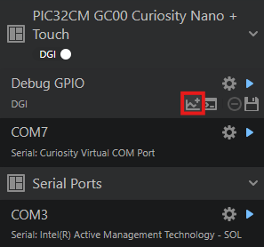

    **Figure 10.** Expected Output

    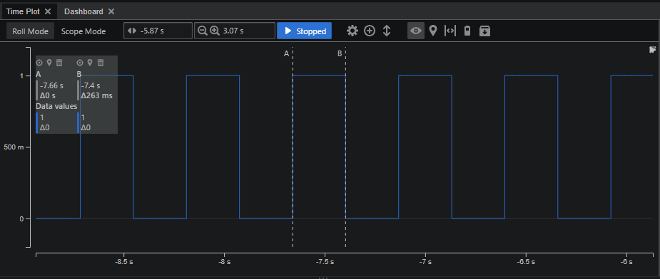

12. <a id="mplab-kit-information"></a>*(Optional)* To look up the details behind the settings used in this example, such as pin assignments, peripheral signal routing, and clock configuration, open the **MPLAB: Kit Information** tab by selecting the PIC32CM GC00 Curiosity Nano + Touch kit in the MPLAB view of the VS Code side bar.

    **Figure 11.** MPLAB® Tools

    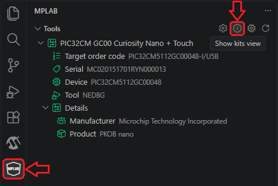

    **Figure 12.** MPLAB® Kit Information

    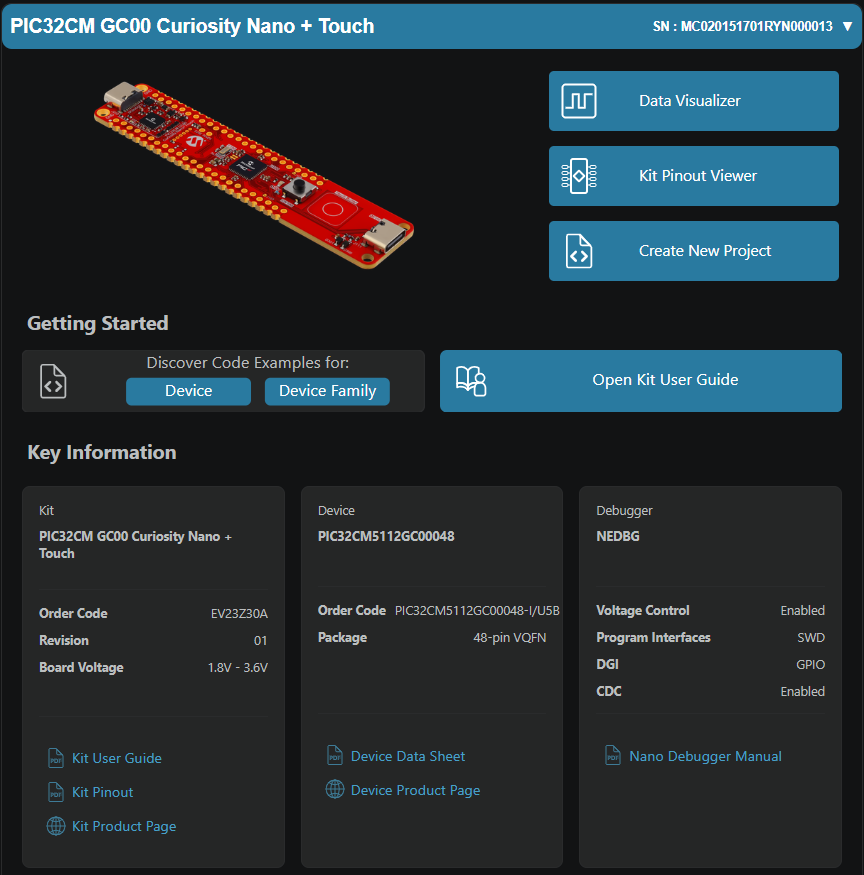

## MPLAB® Code Configurator (MCC) Project Configuration

This example project is preconfigured to work out-of-the-box. To view or verify the configuration of the individual components of the application, the example project can be opened by launching MCC and opening the MCC configuration.

### Clock Configuration

Open the Clock Configurator tool from the Plugins section in the **Project Graph** tab to verify that the RTC clock is 1.024 kHz.

**Figure 13.** Clock Configuration

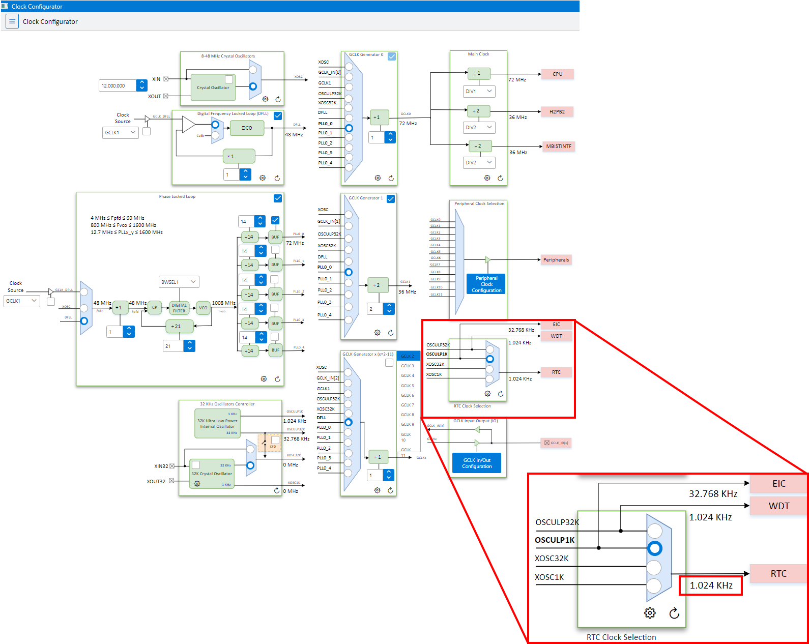

### Pin Configuration

Open the Pin Configurator tool from the Plugins section in the **Project Graph** tab to verify that the following pins are configured as indicated in the Pin Settings table.

**Table 1.** PIC32CM GC00 Curiosity Nano Board Pin Configuration

| Pin Number |  Pin ID  | Custom Name | Function | Direction | Latch |
| ---------- | -------- | ----------- | -------- | --------- | ----- |
|   28       |   PC03   | DEBUG       | GPIO     | Out       | High  |
|   44       |   PD07   | LED0        | GPIO     | Out       | High  |

For the pin allocations of the board, refer to the Kit Pinout Viewer or the [Kit User Guide](https://ww1.microchip.com/downloads/aemDocuments/documents/DEV/ProductDocuments/UserGuides/PIC32CM-GC00-Curiosity-Nano-Touch-DS50004123.pdf), both of which can be opened from the **MPLAB: Kit Information** tab (see [Step 12](#mplab-kit-information)).

### RTC Configuration

In the **Project Graph** tab, click the RTC block to open the RTC Configuration window and verify that the RTC is configured as shown below.

**Figure 14.** RTC Configuration

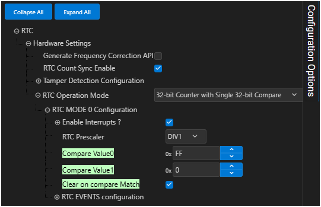

## Application Source Code

The application source code is located in the `main.c` file.

### `Main()` Application Code

```c
int main ( void )
{
    /* Initialize all modules */
    SYS_Initialize ( NULL ); 
    
    /* MCC-generated APIs to assign Timeout_Handler as the interrupt callback function, enable the interrupts, and start the timer */                       
    RTC_Timer32CallbackRegister(Timeout_Handler, 0); 
    RTC_Timer32InterruptEnable(RTC_TIMER32_INT_MASK_CMP0);
    RTC_Timer32Start();

    while ( true )
    {
        /* Maintain state machines of all polled MPLAB Harmony modules. */
        SYS_Tasks ( );
    }

    /* Execution should not come here during normal operation */
    return ( EXIT_FAILURE );
}
```

### Interrupt Handler Code

```c
void Timeout_Handler(RTC_TIMER32_INT_MASK intCause, uintptr_t context)
{
    if(RTC_TIMER32_INT_MASK_CMP0 == (RTC_TIMER32_INT_MASK_CMP0 & intCause ))
    {
        LED0_Toggle();
        DEBUG_Toggle();
    }    
}
```

## Conclusion

At its most basic level, the RTC peripheral can be used to generate a periodic signal that triggers events, or simply to mark the passage of a set amount of time. Using MCC Harmony further simplifies the RTC configuration and software application development, enabling this use case to be implemented as efficiently as possible.

## Related Projects

For more ways to use the RTC peripheral, check out the other RTC example projects:

- [Using the RTC as an Alarm Timer for PIC32CM GC Devices](https://github.com/microchip-pic-avr-examples/pic32cmgc-cnano-rtc-alarm-vscode-harmony.git) 
- [Using the RTC for Tamper Detection With PIC32CM GC Devices](https://github.com/microchip-pic-avr-examples/pic32cmgc-cnano-rtc-tamper-vscode-harmony.git)